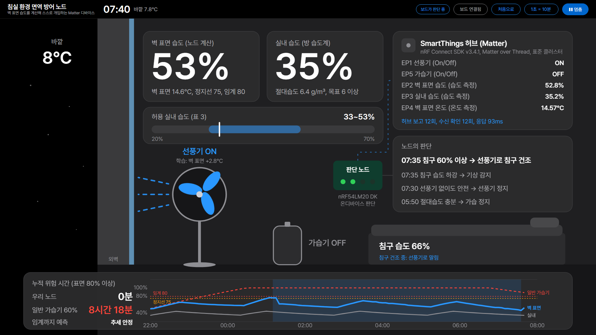
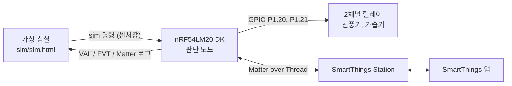

# 침실 환경 면역 방어 노드

벽 표면 습도를 직접 계산해, 곰팡이 임계에 닿기 전에 가습기와 선풍기를 스스로 조절하는 Matter over Thread 디바이스입니다.

지능형 홈(AI@Home) Matter AX Sprint 2026 · 응모 분야 Living Assist · 팀 밤새고 네집내집가기



> 시연의 센서값은 가상 침실 모델(`sim/sim.html`)이 만듭니다. 판단, 예측, 학습, Matter 노출은 모두 nRF54LM20 DK 안에서 합니다.

## 왜 만들었나

방 습도계가 45%를 가리켜도, 한겨울 12℃까지 식은 북측 벽 표면에 닿은 공기는 80%가 됩니다. 곰팡이 임계(ISO 13788)는 방 공기가 아니라 **벽 표면 값**으로 정해지므로, 방 습도계만 보는 일반 가습기는 위험을 알아채지 못합니다.

겨울 침실에는 서로 충돌하는 목표가 세 가지 있습니다.

| 목표 | 기준 | 누가 정하나 |
| --- | --- | --- |
| 수면 | 침실 18~20℃ | 사용자 (Prather, SLEEP 2015) |
| 점막 방어 | 절대습도 6 g/㎥ 이상 | 노드 (Shaman & Kohn, PNAS 2009) |
| 곰팡이·진드기 억제 | 벽 표면 습도 80% 이하 | 노드 (ISO 13788:2012) |

벽 온도에 따라 두 조건을 함께 만족하는 실내 습도 구간이 30%에서 55%까지 달라지고, 벽이 약 7.2℃ 아래로 내려가면 이 구간이 사라집니다. 노드는 이 구간을 0.5초마다 계산해 지키고, 구간이 좁아지면 선풍기로 벽 표면을 데워 다시 넓힙니다.

## 동작 원리

### 계산

```
Pₛ(T)   = 6.112 × exp(17.62·T / (243.12 + T))       포화 수증기압 (Magnus)
RH표면  = RH실내 × Pₛ(T실내) / Pₛ(T벽)               차가운 벽 앞 공기의 습도
AH      = 216.7 × (RH실내/100) × Pₛ(T실내) / (273.15 + T실내)   절대습도 g/㎥
RH상한  = 80 × Pₛ(T벽) / Pₛ(T실내)                    벽 표면이 80%를 넘지 않는 실내 습도
```

예) 방 21℃, 45%, 벽 12℃ → RH표면 = 45 × 24.8 / 14.0 ≈ 80%

### 판단 규칙 ([`firmware/light_bulb/src/decision.c`](firmware/light_bulb/src/decision.c))

| 규칙 | 내용 |
| --- | --- |
| A 곰팡이 방어 | 벽 표면 75%에서 가습 정지, 70% 아래에서만 재개. 그래도 오르면 선풍기로 벽을 데움 |
| B 점막 방어 | 절대습도 6.5 g/㎥ 미만이면 가습, 8 g/㎥에서 정지 |
| C 침구 건조 | 기상 후 침구 습도 60% 이상이면 가습을 멈추고 선풍기로 50% 미만까지 말림 (최대 45분) |
| D 국면 판정 | 침구 습도가 분당 0.3%p 넘게 오르면(실내보다 5%p 이상 습할 때) 취침, 내리면 기상 |
| E 학습 | 선풍기를 켤 때 벽 표면이 몇 ℃ 오르는지 스스로 재서, 꺼도 안전한지 판단 |
| E 예측 | 벽이 식는 추세로 임계 80%까지 남은 시간 계산 |
| 동시 가동 | 선풍기로 넓힌 구간 안에서는 선풍기를 켠 채 가습해 점막 방어와 곰팡이 방어를 함께 지킴 |
| 사용자 우선 | 앱에서 직접 조작하면 30분(가상 시각) 동안 존중. 단 벽 표면 80% 이상이면 방어 우선 |

정지선 75%는 ISO 임계 80%에서 측정 불확실성 5%p를 뺀 값입니다. 표면 80% 이상이었던 시간은 누적 위험 시간으로 따로 셉니다.

## 시스템 구성



- 가상 침실이 바깥 기온, 벽, 실내 수분을 계산해 USB 시리얼(Web Serial, 115200)로 DK에 센서값을 보냅니다.
- DK가 판단한 결과는 릴레이 딸깍과 Matter 속성으로 나가고, 가상 침실이 그 결과를 다시 받아 환경에 반영합니다(닫힌 고리).
- 판단부가 속성을 바꾸면 SDK가 허브로 ReportData를 보냅니다. 시연 화면은 시리얼 로그에서 보고와 수신 확인을 읽어 횟수와 응답 시간을 표시합니다(시연 1회 평균 93ms).
- 허브나 인터넷이 끊겨도 판단과 릴레이 제어는 보드 안에서 계속됩니다.

### Matter 엔드포인트

`light_bulb.zap`에 EP2~EP5를 추가하고 `west zap-generate`로 생성했습니다.

| EP | 디바이스 타입 | 클러스터 | 내용 |
| --- | --- | --- | --- |
| 0 | Root Node | Basic Info 등 | 커미셔닝, Thread 합류 |
| 1 | Dimmable Light | On/Off | 선풍기 (릴레이 IN1) |
| 2 | Humidity Sensor | Relative Humidity | **벽 표면 습도** (노드 계산값) |
| 3 | Humidity Sensor | Relative Humidity | 실내 습도 (방 습도계 값) |
| 4 | Temperature Sensor | Temperature | 벽 표면 온도 |
| 5 | On/Off Plug-in Unit | On/Off | 가습기 (릴레이 IN2) |

앱에서 바꾼 On/Off 값은 `MatterPostAttributeChangeCallback`으로 받아 릴레이와 판단부에 반영합니다. SmartThings 앱은 센서 EP를 표시하지 않아서 시연 화면에서 보여줍니다.

## 폴더 구조

| 경로 | 내용 |
| --- | --- |
| [`firmware/light_bulb/`](firmware/light_bulb/) | **시연용 통합 펌웨어.** Nordic light_bulb 예제 + 판단부(`src/decision.c`) + 출력부(`src/node_outputs.cpp`) + Matter 엔드포인트 5개 |
| [`sim/sim.html`](sim/sim.html) | **시연 화면 = 가상 침실.** 보드가 없으면 같은 판단 로직을 화면 안에서 돌림 |
| [`firmware/relay_test/`](firmware/relay_test/) | 설명서 4단계: 릴레이 딸깍 시험 |
| [`firmware/decision_node/`](firmware/decision_node/) | 설명서 5단계: Matter 없는 판단 시험 (구버전 로직) |
| [`firmware/matter_addon/`](firmware/matter_addon/) | 설명서 6단계 안내 (통합 펌웨어로 대체됨) |
| [`docs/`](docs/) | 장비 테스트 설명서, 시연 방안, 발표자료(PPTX, PDF) |
| [`docs/deck_src/`](docs/deck_src/) | 발표자료 생성 스크립트와 아이콘 |

## 하드웨어

| 장비 | 용도 |
| --- | --- |
| nRF54LM20 DK | 판단 노드 (칩이 **nRF54LM20B**라 보드 타깃은 `nrf54lm20dk/nrf54lm20b/cpuapp`) |
| 2채널 릴레이 모듈 | **LOW에서 켜짐** (`GPIO_ACTIVE_LOW`). IN1 → **P1.20** 선풍기, IN2 → **P1.21** 가습기 |
| SmartThings Station | Thread Border Router, Matter 허브 |
| 노트북 (Chrome) | 시연 화면, DK와 USB 시리얼 연결 (이 PC에서는 **COM3**) |

P1.22는 DK의 LED0이라 쓰지 않습니다.

DK 불빛: LED0 Matter 상태, LED1 선풍기, LED2 가습기, LED3 벽 표면 80% 이상 경고

## 빌드·플래시

nRF Connect SDK **v3.4.1** 기준입니다. 이 PC에서는 SDK가 `D:\ncs`에 있고, 저장소 경로에 띄어쓰기가 있어서 **바로가기 `D:\ORCA\matter-iot`(junction)를 통해** 빌드합니다. PC 메모리가 빠듯하면 `-o=-j4`로 동시 컴파일 수를 줄입니다.

```bash
N="$APPDATA/nrfconnect/nrfutil.exe"; export ZEPHYR_BASE='D:\ncs\v3.4.1\zephyr'
"$N" sdk-manager toolchain launch --ncs-version v3.4.1 --chdir 'D:\ORCA\matter-iot\firmware\light_bulb' -- west build -b nrf54lm20dk/nrf54lm20b/cpuapp -d build -o=-j4 .
"$N" sdk-manager toolchain launch --ncs-version v3.4.1 --chdir 'D:\ORCA\matter-iot\firmware\light_bulb' -- west flash -d build --erase
```

엔드포인트를 바꾼 뒤에는 앱에서 기기를 지우고 `--erase`로 플래시한 다음 다시 등록합니다. 개발용 페어링 코드는 `34970112332`입니다.

## 시연

1. Serial Terminal 등 COM3을 쓰는 프로그램을 모두 닫습니다.
2. `sim/sim.html`을 Chrome으로 엽니다. 버튼이 안 먹히면 `sim` 폴더에서 `python -m http.server 8000`을 실행하고 `http://localhost:8000/sim.html`로 엽니다.
3. **포트 연결** → COM3 선택 → 오른쪽 위가 "보드가 판단 중"으로 바뀌는지 확인합니다.
4. **▶ 한파의 밤**을 누르면 22:00~08:00을 약 60초(1초 = 10분)에 보여줍니다. **⟲ 처음으로**를 누르면 보드의 누적 위험 시간과 학습값까지 초기화됩니다.
5. 오른쪽 위 "Matter 연동" 칸에 SmartThings 허브 보고와 수신 확인이 올라오면 Matter 연결까지 정상입니다.

한파의 밤이 끝나면 누적 위험 시간(표면 80% 이상)이 우리 노드 0분, 방 습도 60%를 유지하는 일반 가습기 약 8시간대로 나옵니다. 정확한 값은 실행마다 조금씩 다릅니다. 장면별 설명과 장애 대응은 [`docs/시연_방안.md`](docs/시연_방안.md)에 있습니다.

보드를 연결하지 않으면 "보드 미연결 · 화면 안 계산"으로 표시되고, 같은 로직이 화면 안에서 돕니다(리허설·백업용).

### 시리얼 명령

| 명령 | 내용 |
| --- | --- |
| `sim <실내온도> <실내습도> <벽온도> <침구습도> [가상시각_분]` | 센서값 입력 (가상 침실이 보냄) |
| `dreset` | 누적 위험 시간, 학습값, 출력 초기화 |
| `hold <초>` | 출력 최소 유지 시간 (기본 60초) |

노드는 0.5초마다 `VAL ... bed=<침구습도> ph=<국면 0 대기, 1 취침, 2 기상> dry=<침구 건조 중>`을, 판단이 바뀔 때 `EVT ... why=<이유>`를 출력합니다.

## 문서

- [장비 테스트 설명서](docs/침실%20환경%20면역%20방어%20노드%20·%20장비%20테스트%20설명서.md): 설치부터 커미셔닝, 릴레이 배선까지 단계별 안내
- [시연 방안](docs/시연_방안.md): 화면 읽는 법, 60초 시나리오, 3분 발표 배분, 장애 대응
- [노트북 세팅](docs/노트북_세팅.md): 새 노트북에서 저장소 받기부터 리허설까지 (에이전트 지침 겸용)
- [발표자료 PDF](docs/발표자료_침실노드.pdf) · [PPTX](docs/발표자료_침실노드.pptx) · [생성 방법](docs/deck_src/README.md)

## 출처와 라이선스

- `firmware/light_bulb/`는 nRF Connect SDK의 Matter light_bulb 예제(LicenseRef-Nordic-5-Clause)를 바탕으로 합니다.
- 글꼴: [Pretendard](https://github.com/orioncactus/pretendard) (SIL OFL 1.1, `sim/fonts/OFL.txt`)
- 발표자료 아이콘: Tabler(MIT), Lucide(ISC), [Streamline](https://www.streamlinehq.com) Ultimate Color(CC BY 4.0)
